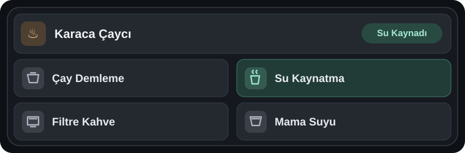
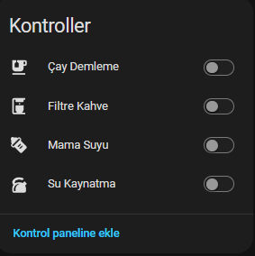
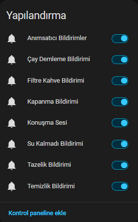
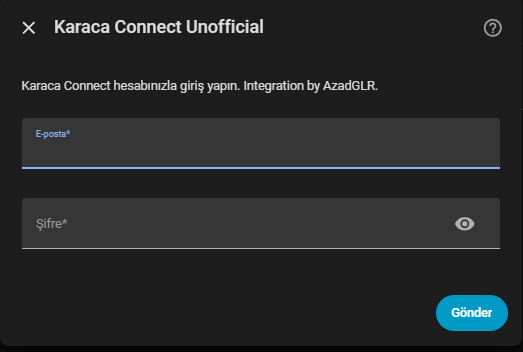

  

<h1 align="center">Karaca Connect Unofficial</h1>

<strong>Karaca Connect cihazları için bağımsız Home Assistant entegrasyonu.</strong>

  <a href="docs/README.en.md">🇬🇧 English</a> ·
  <a href="#kurulum">Kurulum</a> ·
  <a href="#dashboard">Dashboard</a> ·
  <a href="#sık-sorulan-sorular">SSS</a> ·
  <a href="https://github.com/Azadglr/karaca-connect-unofficial/issues">Sorun bildir</a>

  
  
  

> [!IMPORTANT]
> **Bu resmî bir Karaca ürünü değildir.** Karaca tarafından geliştirilmez, desteklenmez veya onaylanmaz. Entegrasyon Karaca Connect bulut API'sine bağlıdır.

## Genel bakış

Karaca Connect Unofficial, uyumlu Karaca cihazlarını Home Assistant üzerinden kontrol etmeyi ve durumlarını izlemeyi sağlar. Cihaz keşfi ve hesapla giriş entegrasyon üzerinden gerçekleştirilir.

| Kontrol | Durum ve ayarlar |
| --- | --- |
| ☕ **Çay Demleme** | `Çay Demleniyor`, `Taze Çay`, `Beklemiş Çay` |
| ♨️ **Su Kaynatma** | `Su Kaynatılıyor`, `Su Kaynadı` |
| 🫖 **Filtre Kahve** | `Kahve hazırlanıyor` |
| 🍼 **Mama Suyu** | `Mama suyu` |

**Test edilen cihaz:** Karaca Çaysever Robotea Pro Connect 4in1 — cihaz türü `robotea4in1`. Diğer modellerin uyumluluğu henüz doğrulanmamıştır.

## Dashboard

  

Şematik tasarım önizlemesi. Gerçek animasyon ve durum bilgisi Home Assistant üzerinde çalışır.

Yeni kompakt görünüm, dört modu **tek dış çerçeve** içinde gösterir. Kart altlarında yinelenen “Çalışıyor/Kapalı” satırları yoktur. Her mod ayrı renkle vurgulanır; **su kaynatılırken** sıcak tonlu yumuşak animasyon, **su kaynadığında** sabit yeşil-turkuaz vurgu kullanılır. Hareketi azaltma ayarı dikkate alınır.

**[Animasyonlu dashboard YAML dosyasını görüntüle ve kopyala](docs/dashboard-animated.yaml)**

<strong>Dashboard'u nasıl eklerim?</strong>

1. HACS üzerinden [custom:button-card](https://github.com/custom-cards/button-card) özel kartını yükleyin.
2. Home Assistant'ta **Dashboard'u düzenle → Kart ekle → Manuel** yolunu açın.
3. [`docs/dashboard-animated.yaml`](docs/dashboard-animated.yaml) dosyasının tamamını yapıştırın.
4. Varlık kimlikleriniz farklıysa `sensor.karaca_cayci_durum` ile dört `switch.karaca_cayci_...` kimliğini değiştirin.

Bu görsel kart **isteğe bağlıdır**. Entegrasyon standart Home Assistant kartlarıyla da çalışır. `stack-in-card` gerektirmez. Gerçek erişim kesintisi görsel olarak gizlenmez.

<strong>Diğer ekran görüntüleri: cihaz, ayarlar ve kurulum</strong>

| Cihaz kontrolleri | Bildirim ve ses ayarları |
| :---: | :---: |
|  |  |
| İlk kurulum | |
|  | |

Ekranlar Home Assistant sürümü ve kullanılan temaya göre farklı görünebilir.

## Kurulum

### HACS ile kurulum (önerilen)

1. Home Assistant'ta **HACS → Özel depolar** bölümünü açın.
2. Depo adresi olarak `https://github.com/Azadglr/karaca-connect-unofficial` yazın.
3. Türü **Integration** seçin ve depoyu ekleyin.
4. **Karaca Connect Unofficial** entegrasyonunu indirin ve Home Assistant'ı yeniden başlatın.
5. **Ayarlar → Cihazlar ve Hizmetler → Entegrasyon ekle** bölümünden **Karaca Connect Unofficial** seçin.
6. Karaca Connect hesabıyla giriş yapın; gerekiyorsa cihaz seçin.

### Manuel kurulum

1. Depodaki [`custom_components/karaca_connect`](custom_components/karaca_connect) klasörünü Home Assistant'taki `/config/custom_components/` konumuna kopyalayın.
2. Home Assistant'ı yeniden başlatın.
3. **Ayarlar → Cihazlar ve Hizmetler → Entegrasyon ekle** üzerinden kurulumu tamamlayın.

**Gereksinimler:** Depo bildirimine göre Home Assistant **2025.3.0+**; HACS ile kurulum için HACS **2.0.0+**. Karaca hesabı ve bulut erişimi gereklidir.

## Nasıl çalışır?

| Konu | Açıklama |
| --- | --- |
| Veri yenileme | Karaca Connect bulutundan yaklaşık **10 saniyede bir** veri sorgulanır |
| Güvenli mod kapatma | Mod yalnızca gerçekten etkinse kapatma isteği bekleme moduna geçirir |
| Tekrar koruması | Mod değiştirme komutlarında **5 saniyelik** bekleme koruması vardır |
| Türkçe durum | Su kaynatılıyor, su kaynadı, çay demleniyor, taze çay ve beklemiş çay gibi API durumları çevrilir |
| Ayarlar | Bildirim, hatırlatıcı, konuşma sesi ve temizlik seçenekleri |
| Bağlantı | Bulut yanıtı alınamazsa Home Assistant varlıkları geçici olarak `unavailable` olabilir |

> [!NOTE]
> `Taze Çay` ve `Beklemiş Çay` cihazdan gelen durumların çevirileridir. Entegrasyonda ayrı bir **1 saatlik çay sayacı** veya bu süreyi değiştirme kontrolü bulunmuyor.

## Sık sorulan sorular

<strong>Su kaynadıktan sonra animasyon neden duruyor?</strong>

Dashboard, cihazın `Su Kaynatılıyor` durumunda hafif animasyon gösterir. `Su Kaynadı` durumunda animasyon durur; yeşil-turkuaz görünüm sabit kalır.

<strong>Bazen “Kullanılamıyor” veya “Bağlantı kontrolü” görünmesi normal mi?</strong>

Durum sorgusunda geçici sorun yaşandığında Home Assistant cihazı `unavailable` olarak işaretleyebilir. Kesin neden loglarla araştırılmalıdır; cihaz arızası olduğu varsayılmamalıdır. İnceleme [Issue #1](https://github.com/Azadglr/karaca-connect-unofficial/issues/1) üzerinden takip ediliyor.

<strong>Animasyonlu kartı yüklemek zorunda mıyım?</strong>

Hayır. Entegrasyonun dört kontrolü, standart Home Assistant kartlarıyla da kullanılabilir. Animasyonlu panel yalnızca örnek bir görsel düzenlemedir.

## Destek ve katkı

Sorun bildirmek veya öneri paylaşmak için [GitHub Issues](https://github.com/Azadglr/karaca-connect-unofficial/issues) bölümünü kullanabilirsiniz. Hata kaydı paylaşırken **parola, erişim anahtarı veya cihaz kimliği** gibi hassas bilgileri çıkarın.

Projeyi desteklemek için [GitHub Sponsors](https://github.com/sponsors/Azadglr) veya [ByNoGame](https://donate.bynogame.com/azadglr) bağlantılarını kullanabilirsiniz.

## Lisans ve sorumluluk

Proje [MIT Lisansı](LICENSE) ile yayımlanır. Kullanım, değişiklik ve yeniden dağıtım koşulları için lisans dosyasına bakın. Bu bağımsız entegrasyonun çalışması Karaca bulut servisindeki değişikliklerden etkilenebilir.

Mevcut entegrasyon sürümü: <strong>1.0.3</strong>. Bu dokümantasyon güncellemesi yeni bir entegrasyon sürümü yayımlamaz.
