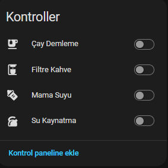

<p align="center"></p>
<h1 align="center">Karaca Connect Unofficial</h1>
<p align="center">Independent Home Assistant integration for Karaca Connect devices · <strong>v1.0.4</strong></p>
<p align="center"><a href="../README.md">🇹🇷 Türkçe</a> · <a href="#installation">Installation</a> · <a href="#dashboard">Dashboard</a> · <a href="../CHANGELOG.md">Changelog</a></p>

> [!NOTE]
> This project is not affiliated with, endorsed by, or supported by Karaca. The integration requires access to the Karaca Connect cloud API.

## Features

| Mode | Reported status examples |
| --- | --- |
| Tea Brewing | Brewing, fresh tea, stale tea |
| Boiling Water | Boiling / boiled |
| Filter Coffee | Coffee brewing |
| Baby Water | Baby water |

Other features include automatic device discovery, a Turkish-language status sensor, notification, reminder and voice settings.

**Tested device:** Karaca Çaysever Robotea Pro Connect 4in1 (`robotea4in1`). Other models have not been verified.

## Installation

1. In HACS, add `https://github.com/Azadglr/karaca-connect-unofficial` as a custom **Integration** repository.
2. Download **Karaca Connect Unofficial** and restart Home Assistant.
3. Select **Settings → Devices & services → Add integration**, sign in and choose a device if prompted.
4. The device display name **Karaca Çaycı** is assigned automatically by the integration.

**Manual setup:** Copy [`custom_components/karaca_connect`](../custom_components/karaca_connect) into `/config/custom_components/`, restart, and add the integration. Repository metadata lists Home Assistant 2025.3.0+ and HACS 2.0.0+.

## Dashboard

<p align="center"></p>

The optional compact dashboard uses colored active tiles, gentle heating animation and a static boiled-water state. Redundant on/off/unavailable subtitles were removed.

Install [button-card](https://github.com/custom-cards/button-card) from HACS, then choose **Edit dashboard → Add card → Manual** and paste the YAML code **directly from this page**:

<details>
<summary><strong>📋 Show and copy animated dashboard YAML</strong></summary>

```yaml
# Karaca Connect Unofficial - Compact animated Lovelace dashboard
# Requires HACS "button-card" custom card, NOT stack-in-card.
# Change entity IDs below if your Home Assistant installation uses different IDs.
# This visual example never hides an actual integration/cloud outage.
type: custom:button-card
show_icon: false
show_name: false
show_state: false
tap_action:
  action: none
styles:
  card:
    - padding: 7px
    - border-radius: 18px
    - background: rgba(18,21,26,.95)
    - border: 1px solid rgba(255,255,255,.085)
    - box-shadow: none
    - overflow: hidden
  grid:
    - grid-template-areas: '"header header" "tea water" "coffee baby"'
    - grid-template-columns: minmax(0,1fr) minmax(0,1fr)
    - grid-template-rows: 43px 43px 43px
    - column-gap: 7px
    - row-gap: 7px
  custom_fields:
    header:
      - width: 100%
      - min-width: 0
    tea:
      - width: 100%
      - min-width: 0
    water:
      - width: 100%
      - min-width: 0
    coffee:
      - width: 100%
      - min-width: 0
    baby:
      - width: 100%
      - min-width: 0
custom_fields:
  header:
    card:
      type: custom:button-card
      entity: sensor.karaca_cayci_durum
      name: Karaca Çaycı
      icon: mdi:kettle-steam
      show_state: true
      state_display: |
        [[[[
          const s = entity?.state ?? '';
          return !s || ['unknown','unavailable'].includes(s.toLowerCase())
            ? 'Bağlantı kontrolü' : s;
        ]]]]
      tap_action:
        action: more-info
      styles:
        card:
          - height: 43px
          - padding: 0 10px
          - border-radius: 12px
          - background: rgba(29,32,38,.94)
          - border: 1px solid rgba(255,255,255,.065)
          - box-shadow: none
        grid:
          - grid-template-areas: '"i n s"'
          - grid-template-columns: 31px minmax(0,1fr) auto
          - grid-template-rows: 1fr
          - column-gap: 9px
        img_cell:
          - width: 31px
          - height: 31px
          - border-radius: 9px
          - background: rgba(228,183,127,.12)
        icon:
          - width: 19px
          - color: '#E4B77F'
        name:
          - justify-self: start
          - font-size: 12px
          - font-weight: 500
          - color: '#EDEEF0'
        state:
          - justify-self: end
          - font-size: 10px
          - font-weight: 500
          - padding: 5px 9px
          - border-radius: 18px
          - max-width: 142px
          - overflow: hidden
          - text-overflow: ellipsis
          - white-space: nowrap
          - background: |
              [[[[
                const s = entity?.state ?? '';
                if (s === 'Su Kaynadı') return 'rgba(92,184,147,.19)';
                if (['Su Kaynatılıyor','Kaynatılıyor'].includes(s)) return 'rgba(244,147,112,.20)';
                if (['unknown','unavailable',''].includes(s.toLowerCase())) return 'rgba(198,154,75,.16)';
                return 'rgba(255,255,255,.075)';
              ]]]]
          - color: |
              [[[[
                const s = entity?.state ?? '';
                if (s === 'Su Kaynadı') return '#9DE2C8';
                if (['Su Kaynatılıyor','Kaynatılıyor'].includes(s)) return '#FFB391';
                if (['unknown','unavailable',''].includes(s.toLowerCase())) return '#E7C88E';
                return '#CBD0D8';
              ]]]]
  tea:
    card:
      type: custom:button-card
      entity: switch.karaca_cayci_cay_demleme
      name: Çay Demleme
      icon: mdi:tea
      show_state: false
      show_label: false
      tap_action:
        action: toggle
      hold_action:
        action: more-info
      styles:
        card:
          - height: 43px
          - padding: 0 10px
          - border-radius: 12px
          - box-shadow: none
          - transition: background .25s ease, border-color .25s ease
          - background: |
              [[[[
                if (entity?.state !== 'on') return 'rgba(29,33,39,.94)';
                
                return 'rgba(229,175,115,.17)';
              ]]]]
          - border: |
              [[[[
                if (entity?.state !== 'on') return '1px solid rgba(255,255,255,.075)';
                
                return '1px solid rgba(229,175,115,.36)';
              ]]]]
      
        grid:
          - grid-template-areas: '"i n"'
          - grid-template-columns: 29px minmax(0,1fr)
          - grid-template-rows: 1fr
          - column-gap: 9px
        img_cell:
          - width: 29px
          - height: 29px
          - border-radius: 9px
          - background: |
              [[[[
                return entity?.state === 'on'
                  ? 'rgba(229,175,115,.19)'
                  : 'rgba(255,255,255,.065)';
              ]]]]
        icon:
          - width: 18px
          - color: |
              [[[[
                if (entity?.state !== 'on') return '#9DA2AA';
                
                return '#E5AF73';
              ]]]]
      
        name:
          - justify-self: start
          - align-self: center
          - font-size: 11.5px
          - font-weight: 500
          - color: '#F0F2F4'
          - white-space: nowrap
  water:
    card:
      type: custom:button-card
      entity: switch.karaca_cayci_su_kaynatma
      name: Su Kaynatma
      icon: mdi:kettle-steam
      show_state: false
      show_label: false
      tap_action:
        action: toggle
      hold_action:
        action: more-info
      extra_styles: |
        @keyframes karaca-heat {
          0%, 100% { box-shadow: inset 0 0 0 1px rgba(255,126,76,.10); }
          50% { box-shadow: inset 0 0 0 1px rgba(255,166,85,.31), 0 0 11px rgba(250,113,64,.13); }
        }
        @keyframes karaca-steam {
          0%, 100% { transform: translateY(0); }
          50% { transform: translateY(-2px); }
        }
        @media (prefers-reduced-motion: reduce) {
          #card, ha-state-icon { animation: none !important; }
        }
      styles:
        card:
          - height: 43px
          - padding: 0 10px
          - border-radius: 12px
          - box-shadow: none
          - transition: background .25s ease, border-color .25s ease
          - background: |
              [[[[
                if (entity?.state !== 'on') return 'rgba(29,33,39,.94)';
                if (entity?.state === 'on' && states['sensor.karaca_cayci_durum']?.state === 'Su Kaynadı') return 'rgba(43,103,87,.36)';
                return 'rgba(244,143,105,.17)';
              ]]]]
          - border: |
              [[[[
                if (entity?.state !== 'on') return '1px solid rgba(255,255,255,.075)';
                if (entity?.state === 'on' && states['sensor.karaca_cayci_durum']?.state === 'Su Kaynadı') return '1px solid rgba(119,213,183,.40)';
                return '1px solid rgba(244,143,105,.36)';
              ]]]]
          - animation: |
              [[[[
                return entity?.state === 'on' && ['Su Kaynatılıyor', 'Kaynatılıyor'].includes(states['sensor.karaca_cayci_durum']?.state) ? 'karaca-heat 2.3s ease-in-out infinite' : 'none';
              ]]]]
        grid:
          - grid-template-areas: '"i n"'
          - grid-template-columns: 29px minmax(0,1fr)
          - grid-template-rows: 1fr
          - column-gap: 9px
        img_cell:
          - width: 29px
          - height: 29px
          - border-radius: 9px
          - background: |
              [[[[
                return entity?.state === 'on'
                  ? 'rgba(244,143,105,.19)'
                  : 'rgba(255,255,255,.065)';
              ]]]]
        icon:
          - width: 18px
          - color: |
              [[[[
                if (entity?.state !== 'on') return '#9DA2AA';
                if (entity?.state === 'on' && states['sensor.karaca_cayci_durum']?.state === 'Su Kaynadı') return '#88DDC5';
                return '#F48F69';
              ]]]]
          - animation: |
              [[[[
                return entity?.state === 'on' && ['Su Kaynatılıyor', 'Kaynatılıyor'].includes(states['sensor.karaca_cayci_durum']?.state) ? 'karaca-steam 1.6s ease-in-out infinite' : 'none';
              ]]]]
        name:
          - justify-self: start
          - align-self: center
          - font-size: 11.5px
          - font-weight: 500
          - color: '#F0F2F4'
          - white-space: nowrap
  coffee:
    card:
      type: custom:button-card
      entity: switch.karaca_cayci_filtre_kahve
      name: Filtre Kahve
      icon: mdi:coffee-maker
      show_state: false
      show_label: false
      tap_action:
        action: toggle
      hold_action:
        action: more-info
      styles:
        card:
          - height: 43px
          - padding: 0 10px
          - border-radius: 12px
          - box-shadow: none
          - transition: background .25s ease, border-color .25s ease
          - background: |
              [[[[
                if (entity?.state !== 'on') return 'rgba(29,33,39,.94)';
                
                return 'rgba(215,160,137,.17)';
              ]]]]
          - border: |
              [[[[
                if (entity?.state !== 'on') return '1px solid rgba(255,255,255,.075)';
                
                return '1px solid rgba(215,160,137,.36)';
              ]]]]
      
        grid:
          - grid-template-areas: '"i n"'
          - grid-template-columns: 29px minmax(0,1fr)
          - grid-template-rows: 1fr
          - column-gap: 9px
        img_cell:
          - width: 29px
          - height: 29px
          - border-radius: 9px
          - background: |
              [[[[
                return entity?.state === 'on'
                  ? 'rgba(215,160,137,.19)'
                  : 'rgba(255,255,255,.065)';
              ]]]]
        icon:
          - width: 18px
          - color: |
              [[[[
                if (entity?.state !== 'on') return '#9DA2AA';
                
                return '#D7A089';
              ]]]]
      
        name:
          - justify-self: start
          - align-self: center
          - font-size: 11.5px
          - font-weight: 500
          - color: '#F0F2F4'
          - white-space: nowrap
  baby:
    card:
      type: custom:button-card
      entity: switch.karaca_cayci_mama_suyu
      name: Mama Suyu
      icon: mdi:baby-bottle
      show_state: false
      show_label: false
      tap_action:
        action: toggle
      hold_action:
        action: more-info
      styles:
        card:
          - height: 43px
          - padding: 0 10px
          - border-radius: 12px
          - box-shadow: none
          - transition: background .25s ease, border-color .25s ease
          - background: |
              [[[[
                if (entity?.state !== 'on') return 'rgba(29,33,39,.94)';
                
                return 'rgba(159,208,179,.17)';
              ]]]]
          - border: |
              [[[[
                if (entity?.state !== 'on') return '1px solid rgba(255,255,255,.075)';
                
                return '1px solid rgba(159,208,179,.36)';
              ]]]]
      
        grid:
          - grid-template-areas: '"i n"'
          - grid-template-columns: 29px minmax(0,1fr)
          - grid-template-rows: 1fr
          - column-gap: 9px
        img_cell:
          - width: 29px
          - height: 29px
          - border-radius: 9px
          - background: |
              [[[[
                return entity?.state === 'on'
                  ? 'rgba(159,208,179,.19)'
                  : 'rgba(255,255,255,.065)';
              ]]]]
        icon:
          - width: 18px
          - color: |
              [[[[
                if (entity?.state !== 'on') return '#9DA2AA';
                
                return '#9FD0B3';
              ]]]]
      
        name:
          - justify-self: start
          - align-self: center
          - font-size: 11.5px
          - font-weight: 500
          - color: '#F0F2F4'
          - white-space: nowrap
```

If entity IDs differ, adjust the status sensor and four mode switches. `stack-in-card` is not needed. This card is optional.

</details>

<details>
<summary><strong>Additional screenshots</strong></summary>

| Device | Settings |
| :---: | :---: |
|  |  |
| Setup | |
|  | |

</details>

## Changes in 1.0.4

- Removed misleading **"Unavailable"** subtitles from the dashboard mode tiles.
- Refined boiling animation, ready-state accent and compact layout.
- Updated documentation in Turkish and English and embedded the YAML example on-page.
- Synchronized integration version metadata.

These changes address **dashboard presentation**, not underlying cloud connectivity or API availability. Cloud status polling is approximately 10 seconds and mode commands have a five-second cooldown. Tea-freshness status comes from the device; this integration does not contain an independent one-hour freshness timer.

## Support and license

[Issues](https://github.com/Azadglr/karaca-connect-unofficial/issues) · [GitHub Sponsors](https://github.com/sponsors/Azadglr) · [ByNoGame](https://donate.bynogame.com/azadglr)

Remove passwords, tokens and device identifiers from shared logs. Licensed under the [MIT License](../LICENSE).
