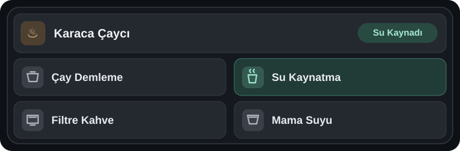
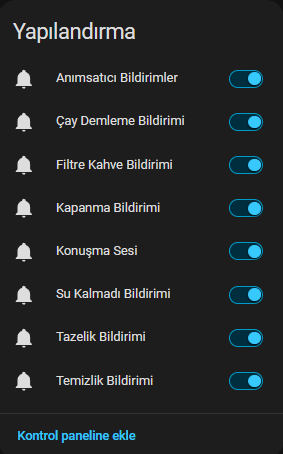
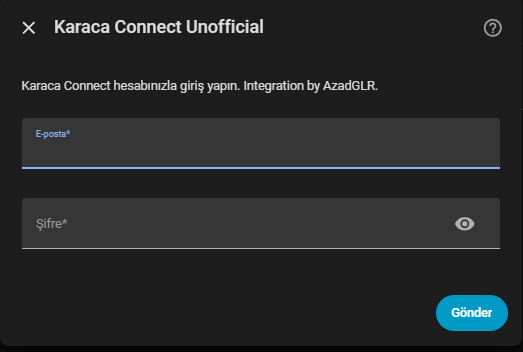

# Karaca Connect Unofficial — English guide

[← Türkçe README](../README.md) · [Animated dashboard YAML](dashboard-animated.yaml) · [Report an issue](https://github.com/Azadglr/karaca-connect-unofficial/issues)

**Karaca Connect Unofficial** is an independent Home Assistant integration for compatible Karaca Connect devices. It is **not affiliated with, supported by, or endorsed by Karaca** and uses Karaca's cloud API.

## Overview

The integration offers four controls: **Tea Brewing**, **Boiling Water**, **Filter Coffee**, and **Baby Water**. It provides automatic device discovery, a Turkish-language status sensor, notification toggles and a voice setting.

**Tested device:** Karaca Çaysever Robotea Pro Connect 4in1 (`robotea4in1`). Compatibility with other models has not been verified.

## Dashboard

Layout illustration; actual animation and live state require Home Assistant.

The optional [animated dashboard YAML](dashboard-animated.yaml) provides a compact four-mode layout with individual accents, without repeated on/off subtitles. It requires the separately installed [custom:button-card](https://github.com/custom-cards/button-card) frontend card (through HACS). The boiling-water tile gently animates while the state sensor says `Su Kaynatılıyor` and becomes static when the sensor says `Su Kaynadı`. `stack-in-card` is **not** needed.

**To use it:** In your Home Assistant dashboard, choose **Edit dashboard → Add card → Manual**, paste the linked YAML, and adjust the entity IDs if yours differ. The integration itself works without this optional card.

<strong>Other screenshots: device page, settings, setup</strong>

| Device page | Settings |
| :---: | :---: |
|  |  |
| Setup | |
|  | |

Appearance may differ across Home Assistant themes and versions.

## Installation

### HACS (recommended)

1. Open **HACS → Custom repositories**.
2. Add `https://github.com/Azadglr/karaca-connect-unofficial` with category **Integration**.
3. Download **Karaca Connect Unofficial** and restart Home Assistant.
4. Go to **Settings → Devices & services → Add integration**.
5. Find **Karaca Connect Unofficial**, sign in with your Karaca Connect account, and choose a device if prompted.

### Manual installation

1. Copy [`custom_components/karaca_connect`](../custom_components/karaca_connect) to `/config/custom_components/karaca_connect`.
2. Restart Home Assistant.
3. Add **Karaca Connect Unofficial** from **Settings → Devices & services**.

Repository HACS metadata specifies **Home Assistant 2025.3.0+** and **HACS 2.0.0+** (for HACS installation). An internet connection to the Karaca cloud is required.

## Controls and behavior

| Feature | Behavior |
| --- | --- |
| Modes | Tea, boiling water, filter coffee and baby water |
| Status | Turkish translations, including `Su Kaynatılıyor`, `Su Kaynadı`, `Taze Çay` and `Beklemiş Çay` when returned by the device |
| Polling | Cloud status refresh approximately every **10 seconds** |
| Safe switching | Turning off a mode sends standby only if that same mode is active |
| Command protection | A **5-second** cooldown is applied to mode commands |
| Notifications | Tea, coffee, freshness, shutdown, no-water, reminder, voice and cleaning settings |

The integration **does not implement a separate one-hour tea-freshness timer**. A temporary cloud/API issue may cause Home Assistant to report entities as unavailable; the optional dashboard does not hide or repair a real outage.

## Troubleshooting

**Why does the status sometimes become unavailable?** A failed refresh or temporary connectivity issue can lead to an unavailable state. The cause must be confirmed from logs before assuming a device fault. Follow [Issue #1](https://github.com/Azadglr/karaca-connect-unofficial/issues/1) for investigation.

**Does the dashboard replace the integration?** No. It is an optional appearance improvement; the default Home Assistant cards remain supported.

[Report a problem](https://github.com/Azadglr/karaca-connect-unofficial/issues). Please remove passwords, access tokens and device identifiers from any logs before sharing.

## Support, license and disclaimer

Support: [GitHub Sponsors](https://github.com/sponsors/Azadglr) · [ByNoGame](https://donate.bynogame.com/azadglr).

Licensed under the [MIT License](../LICENSE). This is an independent project and may be affected by future cloud API changes. Current integration version: **1.0.3**. This documentation refresh is **not** a new integration release.
